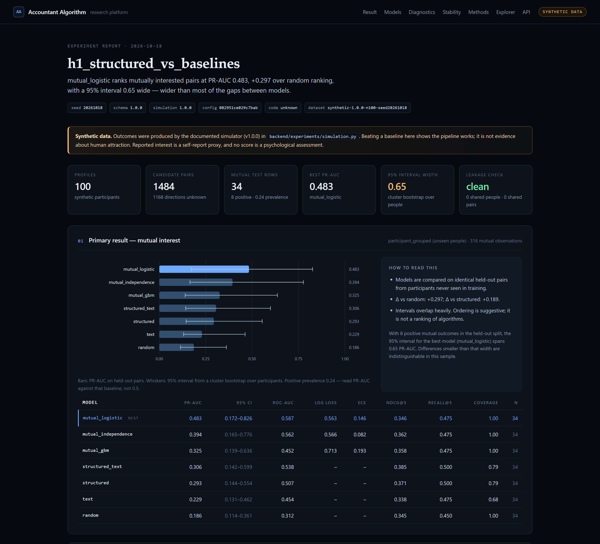
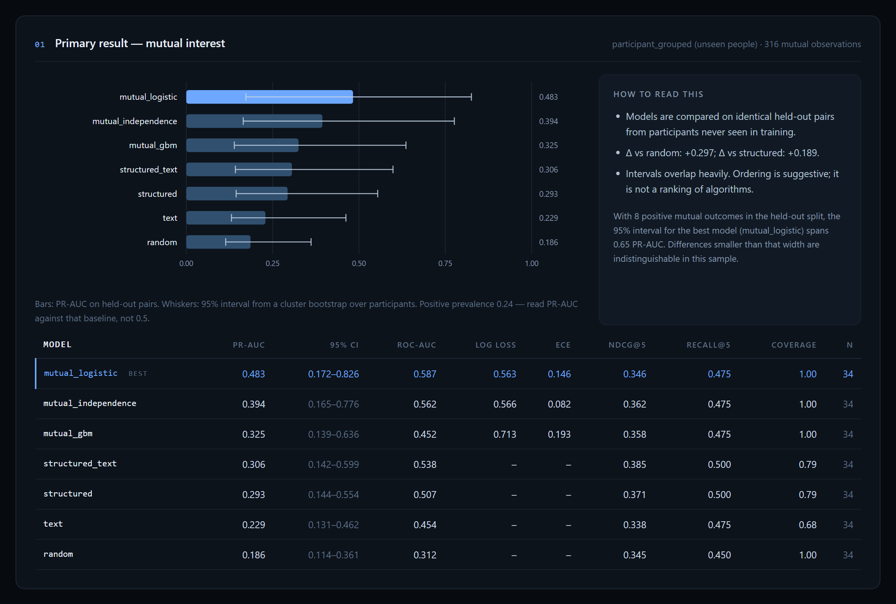
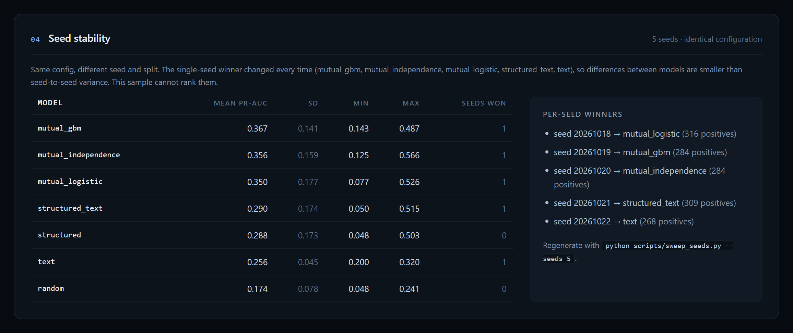
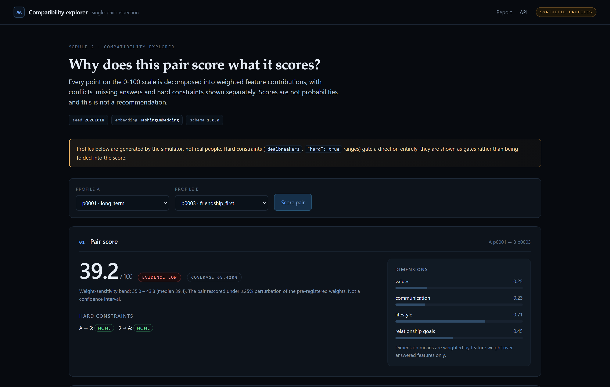
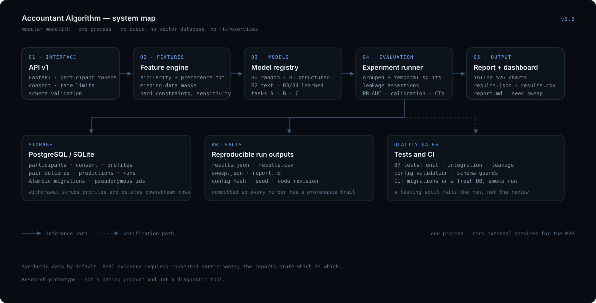

# The Accountant Algorithm


A research platform for one question: **can a structured compatibility model rank
promising matches better than simple baselines — and can it separate profile
attraction from interpersonal compatibility?**

It is not a dating app. There is no messaging, no swiping, no discovery feed, no
photo scoring. It is a benchmark harness, a feature engine, an inspection UI and a
consent-aware API for running small, pre-registered experiments.

Two claims are deliberately kept apart:

* **Reported interest** and **observed interaction outcomes** are measurable.
* **Attraction** is not an objective universal quantity. Scores on the 0–100 scale
  are not probabilities of a relationship, and nothing here is a psychological
  assessment or diagnosis.

The first release is validated on synthetic data only. Synthetic results prove the
pipeline works. They are not evidence about people.

---

## Quickstart

```bash
cd accountant-algorithm
python -m pip install -e ".[dev]"

python -m alembic upgrade head             # schema (or: make migrate)

# 1. run the benchmark (writes results/results.json + results.csv)
python scripts/run_benchmark.py --config configs/experiments/h1_structured_vs_baselines.yaml

# 2. seed-variance check (5 seeds; writes results/sweep.json)
python scripts/sweep_seeds.py --seeds 5

# 3. markdown report
python scripts/make_report.py              # results/report.md

# 4. dashboard + API
python -m uvicorn backend.api.main:app --port 8775
#    http://127.0.0.1:8775/           results dashboard
#    http://127.0.0.1:8775/compare    compatibility explorer
#    http://127.0.0.1:8775/docs       OpenAPI

# 5. tests
python -m pytest -q                            # 90 tests: unit, integration, leakage
```

Larger sample (same hypothesis, 300 synthetic profiles, tighter intervals):

```bash
python scripts/run_benchmark.py --config configs/experiments/h1_power_300.yaml \
  --out results/power
python scripts/make_report.py --results results/power/results.json \
  --out results/power/report.md
```

Optional demo data for the API: `python scripts/seed_demo.py --n 100` creates
synthetic participants (marked `source="synthetic"`).

---

## What the runs actually show

### 100-profile run (`h1_structured_vs_baselines`)

Mutual interest, held-out participants, **34 test pairs, 8 positives**, PR-AUC with
cluster-bootstrap 95% CI:

| model | PR-AUC | 95% CI |
|---|---|---|
| random | 0.186 | 0.114–0.361 |
| structured (B1) | 0.293 | 0.144–0.554 |
| text only (B2) | 0.229 | 0.131–0.462 |
| structured + text | 0.306 | 0.142–0.599 |
| independence product | 0.394 | 0.165–0.776 |
| **mutual logistic (B3)** | **0.483** | 0.173–0.826 |
| mutual GBM | 0.325 | 0.139–0.636 |

Directional interest: random 0.411, structured 0.490, text 0.485, structured+text
0.482, directional logistic 0.498.

The interval for the best model spans **0.65 PR-AUC**. Differences smaller than that
are indistinguishable, so this run cannot rank anything.

### 300-profile replication (`h1_power_300`)

**88 test pairs, 20 positives**, interval width 0.29:

| model | PR-AUC | 95% CI |
|---|---|---|
| random | 0.212 | 0.131–0.342 |
| structured | 0.228 | 0.131–0.373 |
| text | 0.247 | 0.118–0.412 |
| structured + text | 0.232 | 0.132–0.398 |
| independence product | 0.331 | 0.211–0.532 |
| **mutual logistic** | **0.370** | 0.215–0.509 |
| mutual GBM | 0.293 | 0.179–0.489 |

Directional: random 0.389, structured 0.484, text 0.408, structured+text 0.484,
directional logistic 0.495.

At 300 profiles the ordering becomes interpretable — a direct pair model beats the
independence product, which beats the structured baseline, which barely beats random —
but the learned models' intervals still overlap each other.

### The 100-profile winner is not reproducible

Five seeds, identical config, five different winners:

| model | mean PR-AUC | sd | seeds won |
|---|---|---|---|
| mutual GBM | 0.367 | 0.141 | 1 |
| independence product | 0.356 | 0.159 | 1 |
| mutual logistic | 0.350 | 0.177 | 1 |
| structured + text | 0.290 | 0.174 | 1 |
| structured | 0.288 | 0.173 | 0 |
| text only | 0.256 | 0.045 | 1 |
| random | 0.174 | 0.078 | 0 |

Seed-to-seed variance is larger than the gaps between models. Both facts are printed
on the dashboard and in `results/report.md` instead of presenting the luckiest split.
Conclusion for the research plan: **pipeline ready, evidence not** — and more
synthetic pairs would not fix it, only consented participants would.

---

## Interface

The dashboard is a server-rendered research report: held-out metrics with intervals,
calibration, seed stability and feature-level failure cases. No JS build step, no CDN.



Primary result panel — PR-AUC per model with 95% cluster-bootstrap intervals, next to the
interpretation guardrails:



Seed stability — the same configuration under five seeds, with each seed's winner listed:



The compatibility explorer decomposes a single pair into weighted feature contributions,
hard constraints, missing answers and a weight-sensitivity band:



---

## Facts

Measured on this repository, not estimated:

| quantity | value |
|---|---|
| Python | 45 files · 5,875 lines (4,438 application, 1,136 tests, rest scripts) |
| tests | 90 passing in ~45 s (unit, integration, leakage, render) |
| registered models | 11 across 3 prediction tasks |
| database tables | 9 (participants, consent, profiles, experiments, model versions, pair outcomes, runs, predictions, feedback) |
| dashboard | 3 templates + 353 lines of CSS, 0 JS, 0 CDN requests |
| 100-profile benchmark | 1,484 pairs, 157 test pairs, 50 s end to end |
| 300-profile benchmark | 7,909 pairs, 694 test pairs, 124 s end to end |
| mutual-interest rows | 34 (100-profile run) · 88 (300-profile run) — one per pair |
| interval width, mutual PR-AUC | 0.65 at 100 profiles → 0.29 at 300 profiles |
| seed sweep | 5 seeds → 5 different winning models |
| directional PR-AUC, structured | 0.484 vs 0.389 random (300-profile run) |
| leakage | 0 shared participants, 0 shared pairs, asserted inside every run |

## Architecture

Modular monolith, one process, no queue, no vector database, no microservices.

```
backend/
  features/     schema.py (weights, goals, deal-breakers), structured.py (scoring),
                embeddings.py (provider interface + lexical hashing encoder)
  algorithms/   base.py (TaskModel), baseline.py (B0/B1/B2), supervised.py (B3/B4),
                registry.py (one place experiment configs resolve model names)
  experiments/  simulation.py (latent-factor generator), splits.py (grouped +
                temporal + leakage assertions), runner.py (config validation,
                metrics, power note), report.py
  evaluation/   classification.py, ranking.py, calibration.py, stats.py (cluster CI)
  api/          routes.py, schemas.py, main.py, charts.py, templates/
  core/         security.py, consent.py, ratelimit.py
  db/           models.py (9 tables), session.py, migrations/ (Alembic baseline)
tests/          unit/ (features, metrics, simulation, robustness), integration/,
                leakage/
configs/        h1_structured_vs_baselines.yaml, h1_power_300.yaml
scripts/        run_benchmark.py, sweep_seeds.py, make_report.py, seed_demo.py
.github/        ci.yml (tests, migration on a fresh DB, benchmark smoke run)
```



### Deviations from the blueprint (deliberate, documented)

| Blueprint | Here | Why |
|---|---|---|
| Next.js dashboard | server-rendered Jinja2 + inline SVG | one process, no build step; the versioned JSON API is unchanged, so a Next.js client can replace it later without backend work |
| PostgreSQL | PostgreSQL *or* SQLite via `ACCOUNTANT_DB_URL` | zero-setup local runs; `docker compose up` brings Postgres |
| Plotly | hand-rolled SVG | works offline, no CDN, no JS dependency |
| MLflow | results JSON + run rows in Postgres | model configs, seeds and dataset versions are recorded per run; MLflow adds nothing at this stage |

---

## The three prediction tasks

They are never collapsed into one opaque score.

* **A — directional interest**: P(A is interested in B | A's stated preferences, B's
  profile). Scored on PR-AUC/ROC-AUC.
* **B — mutual interest**: P(both independently say yes). A pair-level outcome, not
  the average of two directional scores. The independence product
  `p_AB · p_BA` is one *baseline*; a direct pair model is another.
* **C — interaction quality**: conversation rating, only among pairs who both
  consented and both reported interest. MAE/RMSE.

**Pair-level outcomes are counted once per pair.** Mutual interest and interaction
quality contribute one held-out row each; only directional interest contributes two,
because the two directions have different labels. (An earlier version double-counted
pair rows, which halved the apparent variance and inflated the positive count — now
covered by a test.)

## Feature inventory (schema 1.0.0)

1–5 self-reports, optional text, explicit deal-breakers. Not a validated
psychometric instrument; described as an experimental inventory everywhere.

| dimension | features | weight |
|---|---|---|
| values | ambition, family, independence | 0.42 |
| communication | directness, conflict approach, contact frequency (preference function) | 0.26 |
| lifestyle | social energy, routine structure | 0.17 |
| relationship goals | category match table | 0.10 |
| text | optional embedding cosine | 0.05 |

Similarity-desirable features use `s_i = max(0, 1 − |x_A − x_B| / R_i)` with
`R_i = 4`; complementary features (e.g. A's acceptable contact frequency vs B's
actual) use a preference-satisfaction function. Aggregation is the blueprint's
weighted mean over *answered* features. **Missing answers get mask 0 — never an
imputed value.** Below 60% weighted coverage the score is withheld
(`score: null`, `sufficient_data: false`) rather than invented. Deal-breakers are
hard directional gates applied before ranking.

Three additions beyond the blueprint text:

* **Hard constraints.** A preference can be marked `"hard": true`; falling outside its
  range becomes a directional gate, exactly like a named deal-breaker
  (`"ambition:hard_range"` in `gates`). Soft preferences still only lower the score.
* **Preference shrinkage.** The directional score blends symmetric compatibility with
  the viewer's stated-preference fit, weighted by how many preferences they actually
  answered (`min(1, answered/4)`). One stated range cannot dominate the score.
* **Disclosed uncertainty.** Every score carries an `evidence` level (low/medium/high
  from coverage and completeness) and a **weight-sensitivity band** — the pair
  rescored under ±25% log-normal perturbation of the pre-registered weights, 200
  deterministic draws. It measures dependence on the weight choice, not sampling
  error, and is labelled as such everywhere it appears.

## Baselines and learned models

| id | model | notes |
|---|---|---|
| B0 | `random` | seeded hash of the pair — sanity check |
| B1 | `structured` | pre-registered weights + hard gates |
| B1+text | `structured_text` | ablation: adds the embedding leaf |
| B2 | `text` | cosine over optional self-descriptions |
| B3 | `directional_logistic`, `mutual_independence` | logistic on pair features; product of two directional probabilities |
| B4 | `mutual_logistic`, `mutual_gbm` | direct pair model; regularised tree model |
| C | `interaction_mean`, `interaction_ridge` | rating baselines |

The text encoder is a deterministic signed-hashing TF encoder: it captures **shared
wording, not semantics**. Swap the provider (any object with `.embed()`), bump its
version, and the H2 ablation tests a real semantic encoder.

## Evaluation, and the leakage trap

Matching data has a special failure mode: many pairs share a participant, so a
random row split puts the same person on both sides. Two protocols are implemented:

* **unseen people** (primary) — split participants, drop pairs that straddle the split.
* **known people / temporal** — train on earlier observations, test on later ones.

`assert_no_leakage` and `assert_temporal_order` run inside every experiment and raise
rather than reporting a leak. `tests/leakage` additionally asserts zero shared
participants/pairs, that features never read labels, and that flipping a label does not
change a score.

Metrics: PR-AUC (primary, with prevalence), ROC-AUC, log loss, Brier, ECE + reliability
bins, precision/recall at threshold, NDCG@5, Recall@5, MRR, coverage, goal diversity.
Uncertainty is a **cluster bootstrap over participants**, not rows. Models are compared
on identical held-out pairs. Every run emits a `power_note` translating the interval
width into "differences smaller than this are indistinguishable".

## Consent, privacy and deletion

* Participant tokens are random and stored only as SHA-256 hashes.
* A profile cannot be created without an active consent record — enforced in the app,
  and the study version/purpose must match the supported ones (409/400 otherwise).
* Match responses return aggregate dimensions, contributions, evidence and gates —
  never the other person's answers, interests or text.
* Feedback is directional and idempotent through a unique `(participant, dedupe_key)`
  index; a concurrent duplicate returns the first row instead of raising.
  Mutual interest is "recorded" only when both sides have answered.
* Export returns the participant's own profiles, feedback and *their side* of each pair
  outcome, never the other person's answers.
* Withdrawal scrubs profiles and deletes pair outcomes, predictions and feedback,
  invalidates the token, and marks the participant deleted. Aggregate run metrics
  (no personal data) are retained for reproducibility.
* UUIDs are pseudonyms, not anonymisation: preferences plus interaction records can
  still identify someone. Keep identity mapping separate; the schema never stores
  names, phone numbers or exact locations.

API auth: `X-API-Key` for research operations (set `ACCOUNTANT_API_KEY`;
production refuses to start without it), `X-Participant-Token` for a participant's
own data. The dashboard is unauthenticated and must be bound to localhost.

## API v1

`POST /participants` · `POST /participants/{id}/consent` ·
`POST /participants/{id}/export` · `POST /participants/{id}/withdraw` ·
`POST /profiles` · `POST /profiles/{id}/versions` · `GET /profiles/{id}` ·
`POST /compatibility/score` · `POST /compatibility/rank` · `POST /feedback` ·
`POST /experiments` · `POST /experiments/{id}/runs` · `GET /experiments/{id}/runs` ·
`GET /runs/{id}` · `GET /runs/{id}/results` · `GET /models` · `GET /health`

`/health` performs a database round-trip and reports participant count. Requests get an
`X-Request-ID` and are logged with method, path, status and duration. Participant
creation, scoring and feedback are rate-limited per client IP
(`ACCOUNTANT_RL_PARTICIPANTS=200/60`, `ACCOUNTANT_RL_SCORE=240/60`,
`ACCOUNTANT_RL_FEEDBACK=120/60`; `0/60` disables a scope).

```bash
curl -s localhost:8775/api/v1/compatibility/score \
  -H "X-API-Key: $ACCOUNTANT_API_KEY" -H 'Content-Type: application/json' \
  -d '{"profile_a_id":"...","profile_b_id":"...","model_name":"structured_baseline"}'
```

```json
{
  "task": "compatibility_score",
  "score": 61.4,
  "scale": "0-100",
  "probability": null,
  "sufficient_data": true,
  "coverage": 0.94,
  "evidence": "high",
  "uncertainty": {"method": "weight-perturbation", "sigma": 0.25,
                  "p05": 58.1, "p50": 61.2, "p95": 64.0},
  "dimensions": {"values": 0.62, "communication": 0.71, "lifestyle": 0.48,
                 "relationship_goals": 0.8},
  "explanation": {"contributions": [{"feature": "goal", "points": 10.5}],
                  "conflicts": [{"feature": "social_energy", "points": 2.1}],
                  "missing": ["text"]},
  "limitations": ["Score is on an experimental 0-100 scale; it is not a probability ..."]
}
```

## Robustness notes

* **Config validation** rejects unknown keys, unknown model names, out-of-range
  splits and impossible sample sizes before any work starts.
* **Split guards** refuse datasets too small to evaluate and hard-fail on leakage.
* **DB migrations** via Alembic; `alembic upgrade head` is tested in CI on a fresh DB.
* **Failure visibility**: a run that fails is persisted with `status="failed"` and the
  error, not rolled back into silence.
* **Input caps** on text, interest lists, trait maps, feedback payloads and experiment
  configs; **feature-schema guard** returns 409 when scoring a profile stored under an
  older schema.
* **Rate limiting** on the three write paths that can be abused.
* **Determinism**: profile generation, splits, model seeds and the sensitivity band are
  all seeded; rerunning a config reproduces the numbers.

## Synthetic data generation (why the numbers are what they are)

Three latents (warmth, structure, drive) generate the 1–5 answers. Interest is a
logit over stated-preference fit, latent affinity, topical overlap, the candidate's
profile completeness, the viewer's choosiness, a **shared pair-level shock** (which
is why mutual interest is not the product of two independent probabilities) and
noise; deal-breaker violations are suppressed. Exposure is affinity-weighted, so
exposure bias exists in the data by construction. Interest labels exist only for
exposed directions. The full model is written into every `results.json` under
`simulation`, and into `results/report.md`.

## Roadmap

1. **Before any pilot**: consent screen review, retention job, deletion verification on
   backups, rate limits at the proxy, and a power calculation for the number of
   consented pairs H1 actually needs.
2. **Semantic embeddings**: swap `HashingEmbedding` for a sentence encoder through
   the existing provider interface; rerun the H2 ablation.
3. **Pilot (Phase B)**: usability, completion rate, whether explanations are
   understandable — not prediction accuracy.
4. **Confirmatory (Phase C)**: pre-register H1's metric and split, freeze the test
   set, then evaluate once. Do not tune against it.
5. **Only then**: heavier models. A complex model that cannot beat `structured` on
   held-out participants is not a result.

## Definition of done (blueprint §11)

- [x] Synthetic profiles reproducible from a seed (tested)
- [x] At least three baselines on the same held-out split (seven)
- [x] Every prediction records model + feature-schema version
- [x] Directional feedback preserved; unknown labels never negative
- [x] Participant-grouped evaluation with a leakage suite that fails the run
- [x] Dashboard reports ranking metrics, uncertainty and baseline comparisons
- [x] Consent withdrawal and deletion workflows tested
- [x] Report separates synthetic results from real participant evidence
- [x] Config validation, migrations, rate limits, schema guards, seed sweep

Not done, on purpose: messaging, swiping, discovery, photo scoring, live
recommendations, and any claim that the score predicts relationship success.
